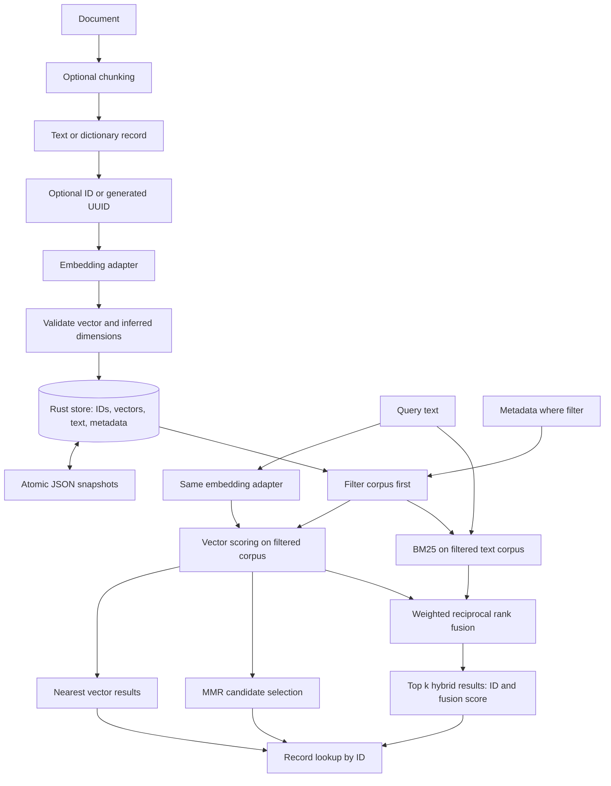
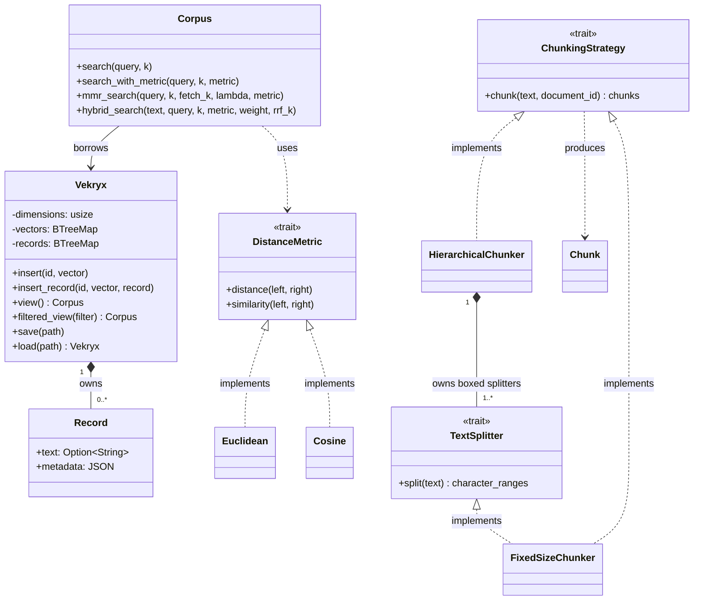

<p align="center">
  
</p>

<h1 align="center">
  <picture>
    <source media="(prefers-color-scheme: dark)" srcset="assets/wordmark-dark.svg">
    <source media="(prefers-color-scheme: light)" srcset="assets/wordmark.svg">
    
  </picture>
</h1>

<p align="center">
  <strong>Exact vector search. Composable Rust. Optional Python.</strong>
</p>

<p align="center">
  <a href="#installation"></a>
</p>

<p align="center">
  <a href="#installation">Install</a> ·
  <a href="#quick-start">Quick start</a> ·
  <a href="#architecture">Architecture</a> ·
  <a href="#repository-structure">File structure</a> ·
  <a href="#traits-and-object-relationships">Traits</a> ·
  <a href="#usage">Usage</a> ·
  <a href="contribution.md">Contribute</a>
</p>

## Overview

Vekryx is an early-stage, in-memory vector search library with native
Rust and optional Python APIs. Store numeric vectors by string ID, retrieve
nearest neighbors, diversify results with maximal marginal relevance (MMR), and
split text into flat or hierarchical chunks before embedding.

The supported store performs an exact scan and sorts matches. It is intended
for small collections; this repository does not publish benchmark results or
claim indexed-search performance. Python can generate embeddings through optional
model adapters; Rust accepts vectors from your application.

The Rust crate and Python package are named `vekryx`; the public store type is
`Vekryx` in both languages. This is a breaking package/API rename: update imports
and rebuild the extension. Existing vector-only JSON snapshots remain readable; new snapshots also retain
original text and metadata when supplied.

## Features

- **Record storage:** optional UUIDs in Python, original text, JSON metadata, and finite `f64` vectors.
- **Filter before search:** exact metadata matching before ranking and candidate limits.
- **Hybrid retrieval:** BM25 keyword search fused with vector rankings using weighted RRF.
- **Exact retrieval:** Euclidean and cosine distances with deterministic ties.
- **Diverse results:** MMR selection over a configurable nearest-candidate pool.
- **Text preparation:** fixed-size, overlapping, and hierarchical parent–child chunks.
- **Explicit persistence:** interoperable JSON snapshots for Rust and Python.
- **Trait-based extension:** independent metrics, flat splitters, and chunking strategies.

The Rust core uses ownership and typed interfaces to separate storage from
search behavior. Python bindings call the same implementation through PyO3.

## Installation

### Rust

Requires **Rust 1.82+**, Cargo, and a native linker/build toolchain. Python is not
required for the default Rust build.

```bash
git clone https://github.com/SuleymanSuleymanzade/Vekryx.git
cd Vekryx
cargo build --lib
cargo run --example rust_usage
```

For another local Rust project, add the repository as a path dependency:

```toml
[dependencies]
vekryx = { path = "/path/to/Vekryx" }
```

### Python

Requires the Rust toolchain above and **Python 3.8–3.12** with `venv` and pip.
Python 3.11 is tested; the pinned PyO3 version does not support Python 3.13/3.14.
From the repository root:

```bash
bash install.sh
source .venv/bin/activate
python examples/python_usage.py
```

The [installer](install.sh) selects a compatible interpreter, creates or reuses
an isolated environment, builds the extension, and checks its import. No sudo,
global pip install, or direct maturin command is needed. Maturin remains the
internal build backend; downloading build dependencies requires network access
unless cached. NumPy is not required.

To select the interpreter or environment explicitly:

```bash
bash install.sh --python python3.11 --venv .venv
```

Run `bash install.sh --help` for options. The script targets Unix-style virtual
environments. Rerun it after changing Rust code. The optional `python` Cargo
feature and extension-module mode are enabled by Python packaging automatically.

## Quick Start

### Rust

```rust
use vekryx::{distance::Cosine, Vekryx};

fn main() -> Result<(), Box<dyn std::error::Error>> {
    let mut store = Vekryx::new(3)?;
    store.insert("chunk-a".into(), vec![1.0, 0.0, 0.0])?;
    store.insert("chunk-b".into(), vec![0.0, 1.0, 0.0])?;

    let matches = store.search_with_metric(&[1.0, 0.0, 0.0], 2, &Cosine)?;
    assert_eq!(matches, vec![("chunk-a".into(), 0.0), ("chunk-b".into(), 1.0)]);

    std::fs::create_dir_all("data")?;
    store.save("data/vekryx.json")?;
    let restored = Vekryx::load("data/vekryx.json")?;
    assert_eq!(restored.len(), 2);
    Ok(())
}
```

### Python

To embed text automatically, install a provider extra in your virtual environment:

```bash
python -m pip install '.[sentence-transformers]'
# Other choices: '.[huggingface]' for hosted inference, '.[openai]' for OpenAI.
```

```python
from vekryx import Vekryx

store = Vekryx(embedding_model="sentence-transformers/all-MiniLM-L6-v2")
cats_id = store.insert("Cats are small domestic animals.")
store.insert("Rust is a systems programming language.")
# Optional explicit ID: store.insert("Some text", id="my-chunk")
print(store.dimensions)  # Inferred from the model's output, never hardcoded.
print(store.search("Tell me about pets", k=1, metric="cosine"))
print(store.mmr_search("Tell me about pets", k=2))
```

An unqualified model string loads a local Sentence Transformers model from
Hugging Face (or a local model directory). This downloads model weights on first
use. To select a hosted provider, pass an adapter instead:

```python
from vekryx import Vekryx, OpenAIEmbeddings, HuggingFaceEmbeddings

# Uses OPENAI_API_KEY; also accepts api_key, base_url, or an existing client.
store = Vekryx(embedding_model=OpenAIEmbeddings("text-embedding-3-small"))

# Select a sentence embedding model deployed by your HF provider/endpoint.
store = Vekryx(embedding_model=HuggingFaceEmbeddings(
    "sentence-transformers/all-MiniLM-L6-v2", token="your-hf-token"
))
```

Hosted model availability depends on your provider. Hugging Face endpoints must
return a single pooled sentence vector; token matrices are rejected rather than
silently pooled. For local models, `SentenceTransformerEmbeddings(model, device="cpu",
revision="commit-or-tag")` allows device and revision selection. Document/query
encoding uses the model's respective methods when available.

The constructor embeds a probe string to infer dimensions. With hosted adapters
this makes an API request and may incur a charge. Subsequent insertions and
queries use the same adapter and validate vector shape and finite values.
Custom adapters implement `embed_document(text)` and `embed_query(text)`, each
returning one numeric vector. Provider errors propagate without replacing stored
vectors. The model can be inspected through `store.embedding_model`.

Snapshots save vectors, dimensions, original text, and metadata. Reattach the **same model and
configuration** with `Vekryx.load(path, embedding_model=model)` to search by text.
Dimensions are checked on load; different models with the same dimensions cannot
be detected. Credentials and model weights are never stored in snapshots. Original
text is retained for text records; `get(id)` returns the stored vector, while
`get_record(id)` returns ID, text, metadata, and vector.

For applications that already generate embeddings, the numeric API remains:

```python
from pathlib import Path
from vekryx import Vekryx

store = Vekryx(dimensions=3)
store.insert("chunk-a", [1.0, 0.0, 0.0])
store.insert("chunk-b", [0.0, 1.0, 0.0])

matches = store.search([1.0, 0.0, 0.0], k=2, metric="cosine")
assert matches == [("chunk-a", 0.0), ("chunk-b", 1.0)]

path = Path("data/vekryx.json")
path.parent.mkdir(parents=True, exist_ok=True)
store.save(path)
restored = Vekryx.load(path)
assert len(restored) == 2
print("Snapshot:", path.resolve())
```

Python `insert` returns the supplied or generated UUID string. Inserting an
existing ID replaces its vector, text, and metadata together; omitted metadata
becomes an empty object. Legacy `insert("id", vector_or_text)` calls still work. Rust `get` returns an `Option`;
Python `get` returns a copy or raises `KeyError`. `delete` returns whether the
record existed in both APIs. IDs must be nonempty, and every vector/query must
match the configured positive dimension and contain only finite numbers.

## Architecture



The diagram uses a fenced `mermaid` block that GitHub renders directly. Metadata
filtering precedes scoring, BM25 corpus statistics, MMR `fetch_k`, and final `k`.
The query embedding is computed independently; only eligible records are ranked.

- [Vekryx](src/store.rs) owns vectors and records, validates mutations, and exposes snapshots.
- [Corpus](src/search.rs) borrows the store for filtered ranking and MMR selection.
- [Hybrid ranking](src/hybrid.rs) combines BM25 and vector ranks after filtering.
- [DistanceMetric](src/distance.rs) separates Euclidean/cosine behavior from storage.
- [TextSplitter and ChunkingStrategy](src/chunking/mod.rs) separate flat splitting from hierarchy construction. `HierarchicalChunker::from_splitters` composes custom splitters.
- [Snapshot writer](src/state_manager/snapshot.rs) replaces JSON files through a temporary file in the same directory.
- [Python bindings](src/python.rs) adapt the store; [chunk bindings](src/chunking/python.rs) expose read-only chunk records.

The experimental KD-tree/LSH prototypes are separate
from the supported store. They do not accelerate `Vekryx`.
There is no persistent CLI store or automatic parent expansion. Python's optional
[embedding adapters](python/vekryx/embeddings.py) prepare vectors before calling
the Rust store.


### Repository Structure

```text
Vekryx/
├── README.md / .gitignore        # Usage guide and generated-artifact exclusions
├── Cargo.toml / Cargo.lock       # Rust features, dependencies, resolved versions
├── pyproject.toml               # Python packaging and optional provider extras
├── install.sh                   # Isolated Python installation
├── src/
│   ├── lib.rs                   # Public Rust API and feature gates
│   ├── main.rs                  # Small supported-store demo: cargo run
│   ├── store.rs                 # Vekryx, Record, CRUD, validated snapshot decoding
│   ├── search.rs                # Borrowed Corpus, exact ranking, MMR
│   ├── hybrid.rs                # BM25 and weighted reciprocal rank fusion
│   ├── distance.rs              # DistanceMetric, Euclidean, Cosine
│   ├── error.rs                 # Shared Error enum
│   ├── python.rs                # PyO3 bridge to the Rust store
│   ├── chunking/
│   │   ├── mod.rs               # Chunk, TextSplitter, ChunkingStrategy
│   │   ├── fixed_size.rs        # FixedSizeChunker: splitter and chunk producer
│   │   ├── hierarchical.rs      # HierarchicalChunker: composes flat splitters
│   │   ├── python.rs            # Python chunk and chunker wrappers
│   │   └── tests.rs             # Unicode, overlap, hierarchy contracts
│   ├── state_manager.rs         # Private persistence module declaration
│   ├── state_manager/
│   │   └── snapshot.rs          # Temporary-file write and atomic replacement
│   └── experimental/            # Optional: --features experimental
│       ├── mod.rs
│       ├── fast_search.rs       # Retrieval-only FastSearch trait
│       ├── kdtree.rs            # Three-dimensional KDTree and typed config
│       ├── vector_db.rs         # Fixed-dimension LinearIndex
│       ├── locality_sensitive_hashing.rs
│       └── persistence.rs       # Serde-based LocalSaver
├── python/vekryx/
│   ├── __init__.py              # Public Python facade, IDs, records, filters
│   └── embeddings.py            # EmbeddingModel protocol and provider adapters
├── examples/
│   ├── rust_usage.rs / python_usage.py
│   ├── hybrid_search.rs / hybrid_search.py
│   ├── basic_usage.py / nearest_neighbors.py / cosine_and_mmr.py
│   ├── hierarchical_chunking.py / persistence.py / embedding_models.py
│   ├── store_smoke.py
│   └── experimental/lsh_prototype.py
├── tests/
│   ├── python_test/test_*.py     # Tests against the installed Python package
│   └── fixtures/legacy_kdtree.json  # Historical experimental snapshot
├── assets/                      # README artwork
├── AGENTS.md                    # Repository conventions
└── contribution.md              # Contributor workflow
```

Rust unit tests also live beside their implementations. Build output (`target/`),
virtual environments, Python caches, wheels, and root-level `data/` snapshots are
Git-ignored. `Cargo.lock` is tracked. The historical KD-tree fixture is separate
from the supported `Vekryx` snapshot format.

### Traits and Object Relationships

Rust structs play the role of objects with state; `impl` blocks provide methods,
and traits describe replaceable behavior. This design uses composition and
interface-style polymorphism. There is no base-store inheritance hierarchy.



`Corpus` is a view, not a subclass of `Vekryx`. It borrows the store and an
optional metadata filter. Rust lifetimes prevent either from being dropped or
mutated while a view is still used. `filtered_view()` copies no stored vectors,
text, or metadata; `filtered()` deliberately builds an independent owned store.
Python's `where=` searches use the borrowed view internally.

| Interface | Implementations | Role and contract |
| --- | --- | --- |
| `DistanceMetric: Send + Sync` | `Euclidean`, `Cosine`, user-defined Rust metrics | Strategy for distance and MMR similarity. Distances must be finite and nonnegative; similarities must be finite and larger for more related pairs. Default similarity is `1 / (1 + distance)`. |
| `TextSplitter: Send + Sync` | `FixedSizeChunker`, user-defined Rust splitters | Return nonempty, in-bounds character ranges in document order. Offsets count Unicode scalar values. |
| `ChunkingStrategy: Send + Sync` | `FixedSizeChunker`, `HierarchicalChunker` | Produce document-scoped `Chunk` records. Hierarchy composes `Box<dyn TextSplitter>`. |
| Python `EmbeddingModel` protocol | `SentenceTransformerEmbeddings`, `HuggingFaceEmbeddings`, `OpenAIEmbeddings`, custom adapters | Implement `embed_document(text)` and `embed_query(text)`; return one finite, nonempty numeric vector. No inheritance is required. |
| Experimental `FastSearch` | `KDTree`, `LinearIndex` | Associated `Vector` type and `nearest_neighbor`; persistence is independent. Experimental LSH has its own candidate API and does not implement this trait. |

Rust retrieval accepts `&dyn DistanceMetric`, so a caller selects a strategy per
search without changing the store type. Python resolves the names `"euclidean"`
and `"cosine"` to those implementations. Arbitrary Python metrics and custom
Python splitters are not exposed by the current bindings; custom embedding
adapters are supported through structural typing.

### Architectural Decisions

| Decision | OOP-style interpretation | Reason and tradeoff |
| --- | --- | --- |
| Keep vectors and records private in `Vekryx` | Encapsulation | Mutations validate IDs, dimensions, and finite values before changing state. Public `Deserialize` also passes through a private, validated snapshot representation. |
| Separate `Corpus` from storage | Read-only view object | Reuse vector, MMR, and hybrid retrieval on the same eligible corpus without cloning stored data. Filter matching and exact scoring still scan entries. |
| Inject metrics through a trait | Strategy pattern and dependency inversion | Retrieval depends on the metric interface; adding a Rust metric does not change storage. Trait objects allow runtime selection. |
| Compose hierarchy from flat splitters | Composition over inheritance | Each level can use a different `TextSplitter`; the hierarchy owns parent/child construction and offset translation. |
| Keep Python orchestration outside Rust search | Facade and adapter patterns | Python handles embedding providers and convenient inputs; PyO3 converts arguments and errors; Rust owns validation and ranking. |
| Use explicit JSON snapshots | Separate persistence responsibility | In-memory storage does not assume a filesystem path. Saving writes a temporary file and renames it; parent directories must exist and writers are not coordinated. |
| Use a shared typed `Error` | Explicit failure contract | Callers can distinguish invalid arguments, invalid snapshot references, and JSON errors. Filesystem APIs return `io::Result`; Python maps invalid input to `ValueError`, missing IDs to `KeyError`, and I/O errors to `OSError`. |
| Gate legacy indexes with `experimental` | Separate experimental subsystem | Default builds do not need `ndarray` or `rand`. These indexes do not accelerate the supported exact store. |
| Keep model objects outside snapshots | Application-owned dependency | Rust and Python exchange the same vectors and records. Python must reattach the same embedding model/configuration for text queries after loading. |

Exact search scores all eligible vectors and sorts results: for `n` eligible
vectors of dimension `d`, ordinary retrieval costs `O(n*d + n*log(n))` and keeps
`O(n)` scored candidates before truncation. A borrowed view avoids corpus copies;
it does not turn the scan into an index or eliminate ranking allocations.

### Rust API Compatibility

Retrieval, metric, and chunking methods return `vekryx::Error`; custom trait
implementations use that error type. `Vekryx::get` returns `Option<&[f64]>`.
`save`/`load` return `std::io::Result`, and `to_json` returns a Serde JSON result.
The supported snapshot fields are shared with Python. Experimental index
representations are separate and should not be treated as supported snapshots.


## Usage

The examples below pair the same workflows in Rust and Python. Each code block
is self-contained unless stated otherwise. Record examples in a separate Rust
application also need `serde_json = "1"` in `[dependencies]`.


### Insert, Update, Retrieve, and Delete

These examples run without an embedding model. Reusing an ID replaces its vector
and clears prior text/metadata unless a replacement record supplies them.

#### Rust

```rust
use vekryx::Vekryx;

fn main() -> Result<(), vekryx::Error> {
    let mut store = Vekryx::new(2)?;
    store.insert("note".into(), vec![1.0, 0.0])?;
    store.insert("note".into(), vec![0.0, 1.0])?;
    assert_eq!(store.len(), 1);
    assert_eq!(store.get("note"), Some([0.0, 1.0].as_slice()));
    assert_eq!(store.search(&[0.0, 1.0], 1)?, vec![("note".into(), 0.0)]);
    assert!(store.insert("bad".into(), vec![1.0]).is_err());
    assert!(store.get("missing").is_none());
    assert!(store.delete("note"));
    assert!(!store.delete("note"));
    Ok(())
}
```

#### Python

```python
from vekryx import Vekryx

store = Vekryx(dimensions=2)
store.insert("note", [1.0, 0.0])
store.insert("note", [0.0, 1.0])
assert len(store) == 1
assert store.get("note") == [0.0, 1.0]
assert store.search([0.0, 1.0], k=1) == [("note", 0.0)]
try:
    store.insert("bad", [1.0])
except ValueError:
    pass
try:
    store.get("missing")
except KeyError:
    pass
assert store.delete("note")
assert not store.delete("note")
```


### Dictionary Records and Filters

#### Rust

```rust
use serde_json::json;
use vekryx::{distance::Cosine, store::Record, Vekryx};

fn main() -> Result<(), vekryx::Error> {
    let mut store = Vekryx::new(2)?;
    for (id, text, vector, domain) in [
        ("cats", "Cats are domestic animals.", vec![1.0, 0.0], "animals"),
        ("rust", "Rust prevents memory errors.", vec![0.0, 1.0], "programming"),
    ] {
        store.insert_record(id.into(), vector, Record {
            text: Some(text.into()),
            metadata: json!({"domain": domain, "language": "en"})
                .as_object().unwrap().clone(),
        })?;
    }
    let filter = json!({"domain": "animals", "language": "en"});
    let corpus = store.filtered_view(filter.as_object().unwrap());
    let matches = corpus.search_with_metric(&[1.0, 0.0], 5, &Cosine)?;
    assert_eq!(matches, vec![("cats".into(), 0.0)]);
    assert_eq!(store.record("cats").unwrap().text.as_deref(), Some("Cats are domestic animals."));
    Ok(())
}
```

#### Python

This adapter produces deterministic toy vectors for an offline demonstration.
Replace it with a real embedding model for semantic retrieval.

```python
from vekryx import Vekryx

class ToyEmbeddings:
    def embed_document(self, text):
        return [1.0, 0.0] if "cat" in text.lower() or "pet" in text.lower() else [0.0, 1.0]

    def embed_query(self, text):
        return self.embed_document(text)


store = Vekryx(embedding_model=ToyEmbeddings())
record_id = store.insert({
    "text": "Cats are domestic animals.",
    "metadata": {"domain": "animals", "language": "en", "published": True},
})
store.insert({
    "text": "Rust prevents many memory errors.",
    "metadata": {"domain": "programming", "language": "en"},
})

# All properties must match BEFORE ranking; excluded records cannot consume k.
matches = store.search("pets", k=5, metric="cosine",
                       where={"domain": "animals", "language": "en"})
diverse = store.mmr_search("pets", k=2, fetch_k=10,
                           where={"domain": "animals"})
record = store.get_record(record_id)  # {id, text, metadata, vector}; owned copy
```

A dictionary record accepts `text`, `metadata`, and optional `id`; `text` must be a
string. For plain text or vectors, use `metadata={...}` on `insert` instead.
`where` matches top-level metadata properties with exact JSON equality and AND
semantics. Nested objects/arrays match as complete values; there are no comparison
operators, dotted paths, or implicit coercions. A missing property does not match
`None`; an explicitly stored JSON null does. An empty filter matches every record,
and no matching records produces `[]`. Metadata keys must be strings and values
must be finite JSON values. Filters apply to vector, MMR, and hybrid search alike.

### Hybrid Keyword and Vector Search

#### Rust

Rust supplies query text for BM25 and an application-generated vector for vector
ranking. The following vectors are toy fixtures, not model embeddings.

```rust
use serde_json::json;
use vekryx::{distance::Cosine, store::Record, Vekryx};

fn main() -> Result<(), vekryx::Error> {
    let mut store = Vekryx::new(2)?;
    for (id, text, vector) in [
        ("cats", "Cats are domestic animals.", vec![1.0, 0.0]),
        ("dogs", "Dogs are domestic animals.", vec![0.8, 0.2]),
    ] {
        store.insert_record(id.into(), vector, Record {
            text: Some(text.into()),
            metadata: json!({"domain": "animals"}).as_object().unwrap().clone(),
        })?;
    }
    let filter = json!({"domain": "animals"});
    let corpus = store.filtered_view(filter.as_object().unwrap());
    let results = corpus.hybrid_search("domestic cats", &[1.0, 0.0], 5, &Cosine, 0.5, 60)?;
    assert_eq!(results[0].0, "cats");
    for (id, score) in results {
        println!("{score}: {}", store.record(&id).unwrap().text.as_deref().unwrap());
    }
    Ok(())
}
```

#### Python

```python
from vekryx import Vekryx


class ToyEmbeddings:
    def embed_document(self, text):
        return [1.0, 0.0] if "cat" in text.lower() else [0.8, 0.2]

    def embed_query(self, text):
        return self.embed_document(text)


store = Vekryx(embedding_model=ToyEmbeddings())
store.insert("cats", "Cats are domestic animals.", metadata={"domain": "animals"})
store.insert("dogs", "Dogs are domestic animals.", metadata={"domain": "animals"})
results = store.hybrid_search(
    "domestic cats", k=5, where={"domain": "animals"}, vector_weight=0.5, rrf_k=60,
)
assert results[0][0] == "cats"
for record_id, score in results:
    print(score, store.get_record(record_id)["text"])
```

`hybrid_search` requires a text query and an embedding model. It applies `where`
first, ranks all eligible vectors by the selected distance (default `cosine`), and
ranks eligible stored text using BM25 (`k1=1.2`, `b=0.75`, positive IDF). Tokenization
splits on non-alphanumeric characters and lowercases Unicode tokens. There is no
stemming or stop-word removal; repeated query tokens count once. BM25 statistics
are computed only from eligible records with text, including empty texts. Records
without original text can contribute to vector results but not keyword results.

The two full rankings are combined using
[reciprocal rank fusion](https://www.elastic.co/docs/reference/elasticsearch/rest-apis/reciprocal-rank-fusion):
`vector_weight / (rrf_k + vector_rank) + (1 - vector_weight) / (rrf_k + keyword_rank)`.
Ranks start at 1; absent ranks contribute zero. `rrf_k` defaults to 60 and must be
positive. `vector_weight` must be finite and between 0 and 1: 0 returns keyword
matches only; 1 uses vector ranks only. A query with no keyword matches falls back
to vector ranking unless its vector weight is zero. Keyword-only mode still embeds
and validates the query. This is exact in-memory retrieval, with no search index.
Python metadata filters and Rust `filtered_view()` borrow the matching corpus;
they avoid copying stored vectors and records.

Hybrid results are `(ID, fusion_score)` with **larger scores first**, unlike the
smaller-is-better distances from `search` and `mmr_search`. Ties sort by ID; only
after fusion are results truncated to `k`. `k=0` returns `[]` after validation.

Rust callers use `insert_record(id, vector, Record { text, metadata })`,
`filtered_view(&metadata_filter)`, and then `hybrid_search(text, query_vector, k,
&metric, vector_weight, rrf_k)` on the borrowed corpus. See the runnable
[Python example](examples/hybrid_search.py) and [Rust example](examples/hybrid_search.rs).

### Distance Selection

| Choice | Use when | Behavior |
| --- | --- | --- |
| Euclidean | Your embedding model expects L2 distance, or magnitude matters. | Default for `search`; smaller is closer. Zero vectors are valid. |
| Cosine | Your embedding model compares direction rather than magnitude. | `1 − cosine similarity`, from 0 to 2. Zero query/stored vectors raise an error. |
| MMR + either metric | You want relevant matches with less repeated context. | Reranks candidates for relevance and diversity; returns original query distances in selection order. |

Choose the metric expected by your embedding model. For unit-normalized vectors,
Euclidean and cosine give the same nearest-neighbor ranking. Ordinary search
breaks distance ties by ID. `k=0` returns no matches after validation; `k` above
the record count returns all records. Euclidean overflow is reported as an error.

#### Rust

```rust
use vekryx::{distance::{Cosine, Euclidean}, Vekryx};

fn main() -> Result<(), vekryx::Error> {
    let mut store = Vekryx::new(2)?;
    store.insert("a".into(), vec![1.0, 0.0])?;
    store.insert("b".into(), vec![0.0, 1.0])?;
    assert_eq!(store.search(&[1.0, 0.0], 2)?,
               store.search_with_metric(&[1.0, 0.0], 2, &Euclidean)?);
    assert_eq!(store.search_with_metric(&[1.0, 0.0], 2, &Cosine)?[0], ("a".into(), 0.0));
    Ok(())
}
```

#### Python

```python
from vekryx import Vekryx

store = Vekryx(2)
store.insert("a", [1.0, 0.0])
store.insert("b", [0.0, 1.0])
assert store.search([1.0, 0.0], k=2) == store.search([1.0, 0.0], k=2, metric="euclidean")
assert store.search([1.0, 0.0], k=2, metric="cosine")[0] == ("a", 0.0)
```

### Diverse Retrieval

MMR is a selection strategy, not a separate distance. Python defaults to cosine
for MMR; Rust accepts a `DistanceMetric` implementation explicitly.

#### Rust

```rust
use vekryx::{distance::Cosine, Vekryx};

fn main() -> Result<(), vekryx::Error> {
    let mut store = Vekryx::new(2)?;
    for (id, vector) in [("a", vec![1.0, 0.0]), ("b", vec![1.0, 0.0]), ("c", vec![0.6, 0.8])] {
        store.insert(id.into(), vector)?;
    }
    let results = store.mmr_search(&[1.0, 0.0], 2, 3, 0.2, &Cosine)?;
    assert_eq!(results.iter().map(|(id, _)| id.as_str()).collect::<Vec<_>>(), vec!["a", "c"]);
    Ok(())
}
```

#### Python

```python
from vekryx import Vekryx

store = Vekryx(2)
store.insert("a", [1.0, 0.0])
store.insert("b", [1.0, 0.0])
store.insert("c", [0.6, 0.8])

results = store.mmr_search([1.0, 0.0], k=2, fetch_k=3, lambda_mult=0.2)
assert [record_id for record_id, _ in results] == ["a", "c"]
```

`fetch_k` must be at least `k`. `lambda_mult` must be finite and between 0 and 1:
higher values favor relevance; lower values favor diversity. The nearest result
is selected first; `1` reproduces nearest-neighbor order. Defaults are `k=5`,
`fetch_k=20`, and `lambda_mult=0.5` in Python.

Cosine MMR uses cosine similarity; Euclidean MMR uses `1 / (1 + distance)`.
Returned numbers are query distances, not MMR scores, and need not be sorted.

### Hierarchical Chunking

| Strategy | Python constructor | Tradeoff |
| --- | --- | --- |
| Fixed size | `FixedSizeChunker(chunk_size=512)` | Predictable bounds; may split words or ideas. |
| Overlapping windows | `FixedSizeChunker(chunk_size=512, overlap=64)` | Retains boundary context but repeats text. |
| Parent–child hierarchy | `HierarchicalChunker(chunk_sizes=[1024, 256])` | Search small leaves, then resolve larger parents through a separate lookup. |

#### Rust

```rust
use std::collections::BTreeMap;
use vekryx::chunking::{ChunkingStrategy, FixedSizeChunker, HierarchicalChunker};

fn main() -> Result<(), vekryx::Error> {
    let text = "Rust stores vectors. Python retrieves chunks.";
    let flat = FixedSizeChunker::new(12, 2)?.chunk(text, "flat-guide")?;
    assert!(flat.iter().all(|chunk| chunk.is_leaf));
    let chunks = HierarchicalChunker::new(vec![32, 12], 2)?.chunk(text, "guide")?;
    let lookup: BTreeMap<_, _> = chunks.iter().map(|chunk| (chunk.id.as_str(), chunk)).collect();
    for leaf in chunks.iter().filter(|chunk| chunk.is_leaf) {
        let parent = leaf.parent_id.as_deref().map(|id| lookup[id]).unwrap_or(leaf);
        let original: String = text.chars().skip(leaf.start).take(leaf.end - leaf.start).collect();
        assert_eq!(original, leaf.text);
        println!("{} -> {}", leaf.id, parent.text);
    }
    Ok(())
}
```

#### Python

```python
from vekryx import FixedSizeChunker, HierarchicalChunker

text = "Rust stores vectors. Python retrieves chunks."
flat = FixedSizeChunker(chunk_size=12, overlap=2).chunk(text, "flat-guide")
assert all(chunk.is_leaf for chunk in flat)
chunks = HierarchicalChunker(chunk_sizes=[32, 12], overlap=2).chunk(text, "guide")
lookup = {chunk.id: chunk for chunk in chunks}

for leaf in (chunk for chunk in chunks if chunk.is_leaf):
    parent = lookup[leaf.parent_id] if leaf.parent_id else leaf
    assert text[leaf.start:leaf.end] == leaf.text
    print(leaf.id, "→", parent.text)
```

Each chunk contains `id`, `parent_id`, `level`, `start`, `end`, `text`, and
`is_leaf`. Sizes and offsets count **Unicode scalar values, not tokens or bytes**;
whitespace is preserved. Hierarchical sizes must be positive and strictly
decreasing; overlap must be nonnegative and smaller than every configured size.
Empty text returns no chunks. Output is breadth-first, with level-zero roots.

Use unique document IDs. Chunk IDs are deterministic positional identifiers;
re-chunking a document requires removing obsolete IDs and replacing its metadata.
Embed leaves with your own model, store their IDs and vectors, and retain the
chunk lookup for parent expansion. See the [complete example](examples/hierarchical_chunking.py).
Semantic, sentence-aware, and code-aware splitters are not implemented.

### Snapshots

Persistence is explicit in both APIs: `save(path)` writes a JSON snapshot and
`load(path)` creates an independent in-memory store. Relative paths resolve
against the process's current working directory. There is no default database
location or automatic saving.

The quick starts and full usage examples write **`data/vekryx.json`**, containing:

```json
{"dimensions":3,"vectors":{"chunk-a":[1.0,0.0,0.0],"chunk-b":[0.0,1.0,0.0]}}
```

The parent directory must exist. Saving replaces the snapshot; concurrent writers
are not coordinated. Chunking results are not saved automatically: persist the
chunk lookup separately, or insert chunk text and hierarchy fields as record text
and JSON metadata. Those record fields are included in snapshots in both APIs.
Root-level `data/` is Git-ignored.

Python reports invalid values/snapshots as `ValueError` and filesystem failures
as `OSError` subclasses. Rust snapshot methods return `std::io::Result`, with
`ErrorKind::InvalidData` for invalid contents. Existing snapshots work across
both languages; metric choice is per search and is not part of the file format.

#### Rust

```rust
use vekryx::Vekryx;

fn main() -> Result<(), Box<dyn std::error::Error>> {
    let path = std::env::temp_dir().join(format!("vekryx-readme-{}.json", std::process::id()));
    let mut store = Vekryx::new(2)?;
    store.insert("a".into(), vec![1.0, 0.0])?;
    store.save(&path)?;
    let restored = Vekryx::load(&path)?;
    assert_eq!(restored.get("a"), store.get("a"));
    let json = store.to_json()?;
    assert_eq!(Vekryx::from_json(&json)?.dimensions(), 2);
    std::fs::remove_file(path)?;
    Ok(())
}
```

#### Python

```python
from pathlib import Path
from tempfile import TemporaryDirectory
from vekryx import Vekryx

with TemporaryDirectory() as directory:
    path = Path(directory) / "store.json"
    store = Vekryx(2)
    store.insert("a", [1.0, 0.0], metadata={"source": "guide"})
    store.save(path)
    restored = Vekryx.load(path)
    assert restored.get("a") == store.get("a")
    assert restored.get_record("a")["metadata"] == {"source": "guide"}
```

Either language can load the other's supported snapshot. Loading a Python text
store with `embedding_model=` reattaches the adapter; loading it without one
still permits numeric-vector searches.

### Extending Through Interfaces

The extension points differ by language: Rust accepts custom metrics and flat
splitters through traits; Python accepts custom embedding adapters through its
`EmbeddingModel` protocol. Python currently exposes built-in metrics and chunkers,
so a Python subclass does not add a native metric or splitter implementation.

#### Rust: Inject a Metric and Compose Splitters

This Manhattan metric validates its public inputs and uses the trait's default
MMR similarity. The custom first-level splitter keeps the complete document;
the fixed-size second level produces smaller children. Neither extension requires
changing `Vekryx` or inheriting from another concrete type.

```rust
use std::ops::Range;
use vekryx::{
    chunking::{ChunkingStrategy, FixedSizeChunker, HierarchicalChunker, TextSplitter},
    distance::DistanceMetric,
    Error, Vekryx,
};

struct Manhattan;

impl DistanceMetric for Manhattan {
    fn distance(&self, left: &[f64], right: &[f64]) -> Result<f64, Error> {
        if left.is_empty() || left.len() != right.len() {
            return Err("vectors must have the same positive dimension".into());
        }
        if left.iter().chain(right).any(|value| !value.is_finite()) {
            return Err("vector values must be finite".into());
        }
        let distance: f64 = left.iter().zip(right).map(|(a, b)| (a - b).abs()).sum();
        if !distance.is_finite() {
            return Err("Manhattan distance exceeds the finite f64 range".into());
        }
        Ok(distance)
    }
}

struct WholeDocument;

impl TextSplitter for WholeDocument {
    fn split(&self, text: &str) -> Result<Vec<Range<usize>>, Error> {
        let length = text.chars().count();
        Ok(if length == 0 { Vec::new() } else { std::iter::once(0..length).collect() })
    }
}

fn main() -> Result<(), Error> {
    let mut store = Vekryx::new(2)?;
    store.insert("a".into(), vec![1.0, 2.0])?;
    assert_eq!(store.search_with_metric(&[0.0, 0.0], 1, &Manhattan)?, vec![("a".into(), 3.0)]);
    let hierarchy = HierarchicalChunker::from_splitters(vec![
        Box::new(WholeDocument),
        Box::new(FixedSizeChunker::new(12, 2)?),
    ])?;
    let chunks = hierarchy.chunk("One document, several child chunks.", "guide")?;
    assert!(chunks.iter().any(|chunk| chunk.parent_id.is_some()));
    Ok(())
}
```

#### Python: Supply an Embedding Adapter

The adapter implements the protocol structurally; it does not inherit from
`EmbeddingModel`. This offline toy feature mapping only demonstrates the contract,
not semantic embedding quality. A real adapter can wrap a local model or service.

```python
from vekryx import EmbeddingModel, Vekryx


class TopicEmbeddings:
    def embed_document(self, text):
        return [1.0, 0.0] if "cat" in text.lower() else [0.0, 1.0]

    def embed_query(self, text):
        return self.embed_document(text)


model: EmbeddingModel = TopicEmbeddings()
store = Vekryx(embedding_model=model)
store.insert("cats", "Cats are domestic animals.")
store.insert("rust", "Rust is a programming language.")
assert store.dimensions == 2
assert store.search("cats", k=1, metric="cosine")[0][0] == "cats"
```

### More Examples

| Example | Covers |
| --- | --- |
| [Rust usage](examples/rust_usage.rs) / [Python usage](examples/python_usage.py) | Matching storage, retrieval, chunking, and disk workflows. |
| [Basic operations](examples/basic_usage.py) | Updates, deletion, missing IDs, and validation. |
| [Nearest neighbors](examples/nearest_neighbors.py) | Distances, ties, and identical vectors under different IDs. |
| [Hybrid retrieval: Rust](examples/hybrid_search.rs) / [Python](examples/hybrid_search.py) | Filtered BM25 and vector fusion. |
| [Cosine and MMR](examples/cosine_and_mmr.py) | Relevance versus diversity. |
| [Hierarchical chunks](examples/hierarchical_chunking.py) | Leaf retrieval and parent expansion with clearly labeled toy features. |
| [Persistence](examples/persistence.py) | Snapshot replacement in a temporary directory. |

```bash
cargo run --example rust_usage -- /tmp/rust-vectors.json
python examples/python_usage.py /tmp/python-vectors.json
python examples/hierarchical_chunking.py
```

The full usage examples replace their selected snapshot with sample records.

## Development

```bash
# Rust core; no Python required.
cargo test --all-targets --features experimental
cargo clippy --all-targets --features experimental -- -D warnings
bash -n install.sh

# Rebuild and test the Python extension.
bash install.sh --python python3.11
source .venv/bin/activate
python -m unittest discover -s tests/python_test -p 'test_*.py'
PYO3_PYTHON="$VIRTUAL_ENV/bin/python" cargo test --lib --features python
```

Tests cover numeric validation, metrics, MMR, hierarchy invariants, disk
persistence, and the installed Python API. Dependency and build configuration
live in [Cargo.toml](Cargo.toml) and [pyproject.toml](pyproject.toml).

See [Contributing](contribution.md) for setup, focused validation, and pull
request guidelines. Public API changes should update both language examples.

## License

This repository currently has no `LICENSE` file or license declaration in
`Cargo.toml`. Licensing terms have not yet been specified.
